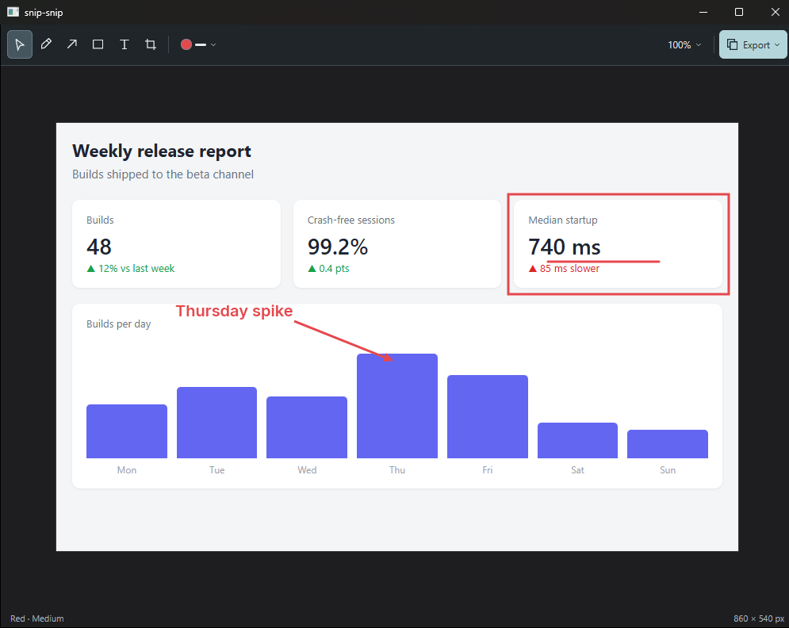

# snip-snip

A screenshot and annotation tool for Windows and macOS, written in Rust and inspired by [Shottr](https://shottr.cc/).



## Download

Grab the Windows or macOS ZIP from [Releases](https://github.com/k-dang/snip-snip/releases/latest). The macOS app isn't notarized yet, so after unzipping, run `xattr -dr com.apple.quarantine snip-snip.app` before opening it.

## Run from source

Install [rustup](https://rustup.rs/), then:

```sh
cargo run --release -p snip-gpui
```

On macOS without full Xcode, add `--features gpui_platform/runtime_shaders`. macOS asks for Screen Recording permission on the first snip.

The app lives in the tray / menu bar. Press `Alt+Shift+S` (changeable in **Settings**) or choose **New snip**, drag over a region, and it opens in the editor.

## Shortcuts

| Key | Action |
| --- | --- |
| `V` `P` `A` `R` `T` `C` | Select, Pencil, Arrow, Rectangle, Text, Crop |
| `Shift` while drawing | Snap arrows to 45° / make rectangles square |
| `Delete` | Remove the selected annotation |
| `Ctrl/Cmd+Z`, `Ctrl/Cmd+Shift+Z` | Undo, redo |
| `Ctrl/Cmd+scroll`, `Space`+drag | Zoom, pan |
| `Ctrl/Cmd+0`, `Ctrl/Cmd+1` | Fit, 100% |
| `Ctrl/Cmd+C` | Copy and close |
| `Ctrl/Cmd+U` | Copy to cloud and close (signed in) |
| `Ctrl/Cmd+S` | Save as PNG |
| `Esc` | Back out of the current action, then close |

## Cloud snips

Optionally, copy a snip on one machine and paste it on another. In **Settings**, choose **Sign in with Cloudflare**. Your snips go to a `snip-snip` R2 bucket in your own Cloudflare account, so snip-snip runs no servers and never sees them. R2 has to be enabled on the account once, from the Cloudflare dashboard.

While signed in:

- **Copy to cloud** in the editor's Export menu copies the snip and uploads it.
- **Copy latest cloud snip** in the tray / menu bar puts the newest cloud snip on the clipboard.
- **Cloud library** in the tray / menu bar shows recent cloud snips. Click one to copy it, or delete it.

Snips stay in the bucket until you delete them. To expire them automatically, add a lifecycle rule to the bucket in the Cloudflare dashboard. Signing out only forgets the session on that machine.

Sign-in is limited to members of the maintainer's Cloudflare account for now.

## Development

- `crates/snip-core` — document model and renderer (no UI dependencies)
- `crates/snip-cloud` — Sign in with Cloudflare and the R2 bucket (no UI dependencies)
- `crates/snip-gpui` — the app: shortcut, capture, selection overlay, editor

```sh
cargo test
cargo clippy --all-targets
cargo fmt
```
